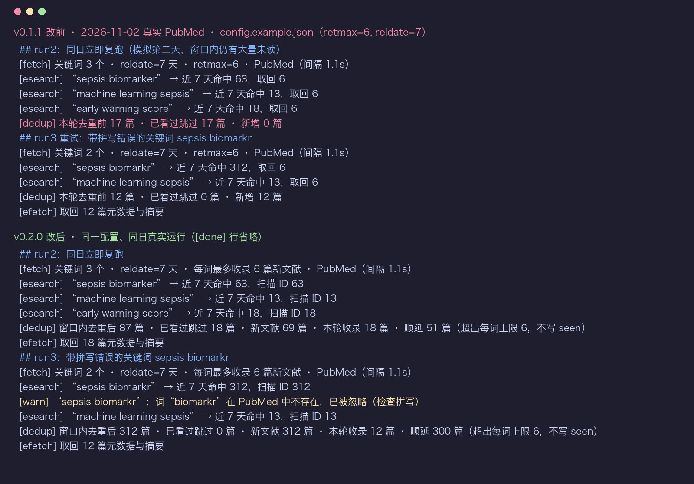
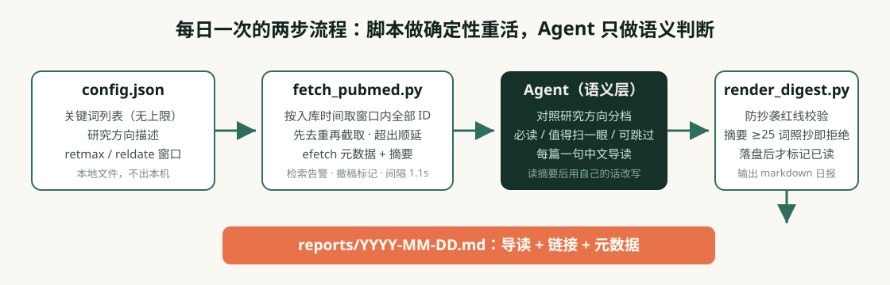
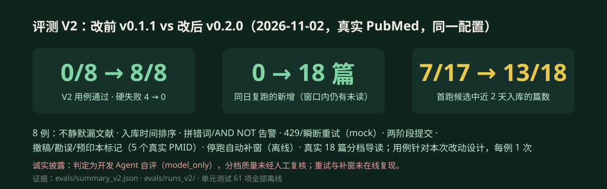

# 医学文献日报 literature-daily

  

给科研人和临床医生的 PubMed 订阅日报：把你的关键词和研究方向交给 Agent，每天拿到一份
"必读 / 值得扫一眼 / 可跳过"分好档、每篇带中文一句话导读的文献清单。

脚本按 PubMed 入库时间增量抓取，先和你读过的去重再截取，超出数量的顺延到下一期，
不会悄悄丢掉；检索式被 PubMed 静默改写时会提醒你；撤稿、勘误、预印本单独标出。日报里只有
导读、链接和元数据，不复制摘要原文，全部处理在本机完成。

## 当前版本真实跑出来的效果

  

上图逐字取自 2026-11-02 对真实 PubMed 的两次运行（同一份 3 个脓毒症关键词的示例配置，
每词上限 6 篇、窗口 7 天，无 api_key、请求间隔 1.1s；只省略了写文件的 `[done]` 行）。
完整记录：[改前](evals/runs_v2/before/live_transcript_before.txt)、[改后](evals/runs_v2/after/live_transcript_after.txt)。

- **改前（v0.1.1）**：7 天内 3 个关键词共命中 94 篇（去重后 87 篇），第一次只给出 17 篇；
  第二天再跑，新增是 **0**。原因是截断发生在去重之前，排在前面的已读文献占满了名额，
  剩下 70 篇未读的一直排不进来，而且没有任何提示。把 `biomarker` 拼成 `biomarkr` 时，
  PubMed 直接丢掉这个词、只搜 sepsis（命中 312），脚本也不出声。
- **改后（v0.2.0）**：第二天收录 18 篇新文献，另有 51 篇明确写出"顺延"；拼错的词当场告警，
  日报统计区同时写出 PubMed 实际执行的检索式。

这 18 篇由 Agent 对照研究方向分档后的日报：
[live_digest_run2_2026-11-02.md](evals/runs_v2/after/live_digest_run2_2026-11-02.md)（3 必读 / 7 值得扫一眼 / 8 可跳过）。节选：

> **🔴 必读 · 1.** AI/ML-enabled sepsis prediction systems: laboratory considerations from development to deployment（[PMID 42937359](https://pubmed.ncbi.nlm.nih.gov/42937359/)）
> J Clin Microbiol · 2026 Oct 27
> **导读**：面向检验科的综述：已部署的脓毒症 AI 预警高度依赖化验输入，换检测平台、试剂或参考区间都会造成输入分布漂移、拖垮模型表现，而临床与检验科目前都缺乏监测手段。
> **理由**：直接对应"床旁落地"中最容易被忽略的部署后漂移问题，可用于本课题外部验证与上线监测方案的设计清单。

同一期里，"early warning score"这个裸关键词还命中了水电站轴承振动预警、牛呼吸道病监测，
都被分到"可跳过"。这说明关键词最好加字段标签收窄，写法见[维护文档](docs/usage.md)。

  

## 能力与边界

| 能力 | 边界 |
| --- | --- |
| 按入库时间（PubMed "Most Recent"）增量抓取，先去重再截取；超出每词上限的顺延到下一期并在日报里写明 | 检索式持续过宽时，顺延的条目仍可能滑出时间窗口，日报会提示收窄 |
| 几天没跑会自动把窗口补到上次运行之后（最多 60 天） | 出版超过 12 个月才被 PubMed 收录的旧文不会进窗口（PubMed 的入库日期规则） |
| 拼错的词、找不到的引号短语、被忽略的 NOT 都会告警，并给出 PubMed 实际执行的检索式 | 只报 PubMed 明确返回的告警，检索式本身是否"好"仍需你判断 |
| 撤稿、撤稿声明、勘误、关注声明、预印本、述评、图书章节自动打标；把已撤稿文章列为必读时渲染会被拒绝 | 标记依赖 PubMed 的出版类型，刚撤稿还没更新到记录的文章识别不到 |
| 日报渲染成功后才标记已读；定时任务抓了但当天没分档，也不会丢文献 | 不提供云端定时和邮件投递，定时请用本机计划任务 |
| 防抄袭：导读含摘要原文连续 25 词以上的片段时拒绝渲染 | 只能拦住直接粘贴英文原文，整句翻译要靠 Skill 规则约束 |
| 纯 Python 标准库；网络瞬断、限流时自动退避重试 2 次 | 无影响因子过滤、无全文获取；分档不会根据你的反馈自动调整 |

## 如何安装与使用

把本仓库放进你的 Agent 技能目录（仓库里带有安装脚本，也可以直接复制整个文件夹），然后对 Agent 说：

> "这是我的研究方向和关键词，帮我出一份本周 PubMed 文献日报。"

Agent 会先给你一份配置确认，然后抓取、分档、写导读、渲染日报。如果出现检索告警或顺延，
它会先告诉你，再建议怎么改关键词。之后每天只需要说：

> "出今天的文献日报。"

已读的文献不会重复出现，几天没跑也会自动补上中间的部分。配置字段、命令行参数、退出码、
检索式写法和定时运行见[维护文档](docs/usage.md)（含 NCBI 免费 api_key 的用法）。

## 对标与参考

这一版的改动来自第二轮调研。我们对照了同类产品的做法、PubMed 官方口径和方法学文献，
详细记录（附来源与检索日期）见[对标文档](references/benchmarks.md)。

| 参考对象 | 借鉴了什么 | 本项目的不同 |
| --- | --- | --- |
| [My NCBI 保存检索与邮件提醒](https://pubmed.ncbi.nlm.nih.gov/help/) | "自上次以来"的取新语义 → 自动补窗、渲染后才标记已读 | 增加语义分档、中文导读和跨关键词去重 |
| [PubMed Help 的日期与排序定义](https://pubmed.ncbi.nlm.nih.gov/help/) | "Most Recent 按入库日期，不按出版日期" → 改用入库时间排序 | — |
| [paper-morning](https://github.com/jeong87/paper-morning)、[zotero-arxiv-daily](https://github.com/TideDra/zotero-arxiv-daily) | 先粗筛出短名单再交给模型，控制每期数量 | 数据源是 PubMed，不依赖 Zotero 文库 |
| [Semantic Scholar Research Feeds](https://www.semanticscholar.org/faq/what-are-research-feeds)、[LitSuggest](https://pmc.ncbi.nlm.nih.gov/articles/PMC8262723/) | 用户正/负反馈让推荐越用越准 | 暂未实现，列为已知限制 |
| [Stork 文献鸟](https://www.storkapp.me/) | 中文用户愿意为"导读"付费，说明需求真实存在 | 本地运行、无订阅费；不做影响因子过滤 |
| [LLM 文献初筛的荟萃分析（JMIR 2025）](https://www.jmir.org/2025/1/e67488) | 模型初筛的召回不稳定 → 拿不准时分到"值得扫一眼"，不直接跳过 | — |

## 评测结果

**V2（2026-11-02，v0.2.0 对比 v0.1.1）**：8 个针对本次改动设计的用例（回归、普通、边界、
对抗各类），同一配置、同日真实 PubMed，每例 1 次。v0.1.1 通过 0/8（4 例硬失败，
都是"静默漏文献"或"按被改写的检索式出报"），v0.2.0 通过 8/8（0 硬失败）。用例专为
这次改动设计，所以旧版 0/8 是预期结果，不代表它的解析、版权校验和渲染能力有问题。

  

| 指标（同一配置、同日真实运行） | v0.1.1 | v0.2.0 |
| --- | --- | --- |
| 第二天再跑的新增篇数（窗口内仍有未读） | 0 | 18（另明示顺延 51） |
| 首跑候选里近 2 天入库的篇数 | 7/17 | 13/18 |
| 拼错关键词 / 错误的 AND NOT 写法 | 无提示 | 告警，并给出实际检索式 |
| 定时抓取后未分档、重复抓取 | 已标记已读，候选被覆盖后丢失 | 已读记录不变，两次候选一致（12 篇） |
| 撤稿/勘误/关注声明/预印本（5 个真实 PMID） | 无标记 | 5/5 判对 |

- 逐题判断：[judgments_v2.jsonl](evals/judgments_v2.jsonl)；汇总：[summary_v2.json](evals/summary_v2.json)；
  指标口径：[comparison_v2.json](evals/runs_v2/comparison_v2.json)；问题清单与改/不改理由：
  [迭代记录](evals/iteration_notes.md)。
- 单元测试 61 项（全部离线），只用来保证脚本行为，不代表日报质量。
- V1（2026-09-19，v0.1.0/0.1.1）的结果保留在 [evals/README.md](evals/README.md)。需要更正一点：
  V1 把"同日复跑 0 新增"判为去重成功，那其实就是上面说的漏文献缺陷。

## 失败案例与已知限制

- **分档和导读是 AI 生成的**，由开发用的 Agent 自评（model_only），还没有请医学信息学背景的人
  人工复核。导读只用来筛读，引用结论前请回到原文。
- 网络重试用 mock 测试验证，长时间未运行后的自动补窗用离线夹具验证，**这两项都没有在真实网络
  上复现过**。
- 宽泛关键词（例如示例配置里的 "sepsis biomarker"，7 天 63 篇）每天的新增都会超过上限，
  顺延数量会一直增加。这时请收窄检索式，或调大每词上限。
- 没有用户反馈闭环：你把某篇标成"不相关"，下次分档不会因此变化。
- 评测夹具是合成数据（PMID 99010001–99010006 为占位编号）；真实运行入库的候选清单已把摘要字段
  脱敏，避免转载出版方的版权内容。

## 社区与许可

- 社区讨论：[LINUX DO](https://linux.do/)
- 许可证：Apache License 2.0（见 [LICENSE](LICENSE)；PubMed 数据与合成夹具的版权说明见 [NOTICE](NOTICE)）
