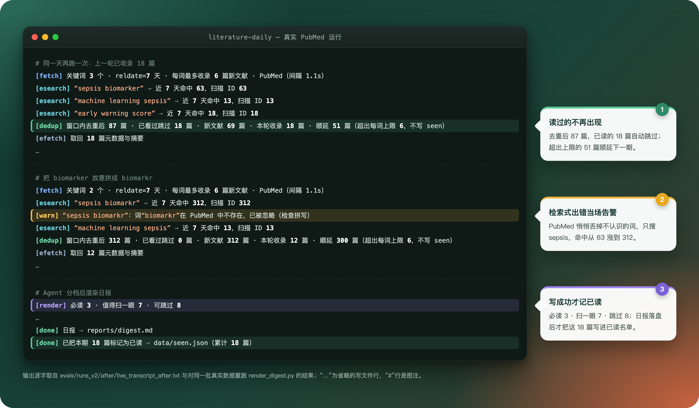
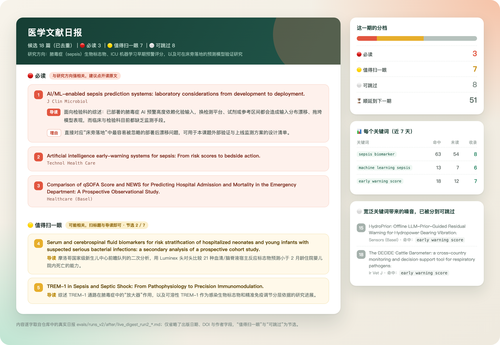
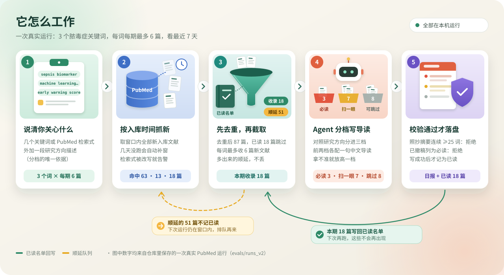
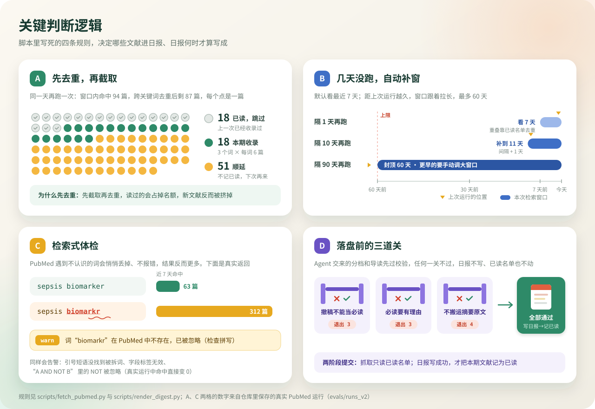

# 医学文献日报 · literature-daily

**订阅 PubMed 关键词，每天一份按你的研究方向分好档、带中文一句话导读的文献清单。**

---

## 效果展示

下面是对真实 PubMed 的一次运行。示例配置订阅了 3 个脓毒症方向的关键词，
每个词每期最多 6 篇，看最近 7 天。

- **读过的不再出现**：窗口内 87 篇去重后，18 篇已读自动跳过，本期收录 18 篇。
  超出上限的 51 篇顺延到下一期，不会被悄悄丢掉。
- **检索式出错会提醒你**：`biomarkr` 拼错后，PubMed 会丢掉这个词、只搜 sepsis（命中 312 篇）。
  脚本当场给出告警，免得你拿着一份跑偏的日报。

这 18 篇交给 Agent 对照研究方向分档后，得到的日报是 **3 篇必读、7 篇值得扫一眼、8 篇可跳过**：

同一期里，`early warning score` 这个宽泛的词还命中了水电站轴承振动预警、牛呼吸道病监测，
它们都被分到了“可跳过”，你不用逐篇点开就能略过。完整内容见 [完整日报](evals/runs_v2/after/live_digest_run2_2026-11-02.md)。

## 它能做什么

- **只给你新的**：按 PubMed 入库时间取新，读过的自动跳过；几天没跑会自动把中间的补上（最多 60 天）。
- **按研究方向分三档**：必读、值得扫一眼、可跳过。前两档每篇都有一句中文导读和推荐理由。
- **检索式体检**：拼错的词、找不到的引号短语、被 PubMed 忽略的 NOT，都会告警并写出实际执行的检索式。
- **特殊文献打标**：撤稿、勘误、关注声明、预印本、述评会单独标出；把已撤稿的文章列为必读时，日报会拒绝生成。
- **不搬运原文**：导读里出现摘要原文连续 25 个词以上，日报直接拒绝生成。
- **不怕中断**：日报写成功后才把文献记为已读；定时任务抓了但当天没处理，第二天也不会漏。

判断规则用图解说明如下：先去重再截取、几天没跑自动补窗、检索式被改写时告警、落盘前的三道校验。

## 适合谁

| 你是 | 典型用法 |
| --- | --- |
| 临床医生 | 订阅自己专科的几个关键词，每天早上花几分钟看完必读档 |
| 研究生、科研人员 | 写明课题方向，让新发表的相关研究自动找上门 |
| 课题组 | 统一一份研究方向描述，定期产出组内文献速递 |
| 系统综述、指南跟踪 | 用精确检索式持续盯住新入库文献，减少遗漏 |

## 如何安装

把本仓库的 GitHub 地址发给你正在用的 Claude Code、Codex、OpenClaw 或其他支持 Skills 的 Agent：

> 请安装这个 Skill 仓库，装好后确认它出现在可用 Skills 里。

也可以下载压缩包，把**整个文件夹**放进 Agent 的 Skills 目录。只拿走 SKILL.md 的话，抓取和渲染脚本不会一起装上。
安装后重开一次会话，让 Agent 重新加载 Skill 列表。

## 如何使用

第一次使用，说清你的方向和关键词：

> 我做脓毒症生物标志物和 ICU 早期预警模型，关键词是 sepsis biomarker、machine learning sepsis、early warning score。帮我出一份本周的 PubMed 文献日报。

Agent 会先给你确认一份配置，再抓取、分档、写导读、生成日报。之后每天只要说：

> 出今天的文献日报。

也可以让它帮你调关键词：

> 最近每天都有很多顺延，帮我把检索式收窄一点，只看标题里出现 sepsis 的。

配置项、检索式写法、定时运行和 NCBI 免费 api_key 的用法，见 [使用与维护文档](docs/usage.md)。

## 对标与参考

| 参考对象 | 它的做法 | 本项目 |
| --- | --- | --- |
| [My NCBI 邮件提醒](https://pubmed.ncbi.nlm.nih.gov/help/) | 推送保存检索的新结果 | 同样“自上次以来”取新，另加分档和中文导读 |
| [Stork 文献鸟](https://www.storkapp.me/) | 关键词订阅，付费 AI 导读 | 本机运行，无订阅费 |
| [Semantic Scholar Research Feeds](https://www.semanticscholar.org/faq/what-are-research-feeds) | 根据你的反馈推荐论文 | 用一段研究方向描述分档，暂不学习反馈 |
| [zotero-arxiv-daily](https://github.com/TideDra/zotero-arxiv-daily) | 按 Zotero 文库推荐 arXiv 新论文 | 数据源是 PubMed，不依赖 Zotero |

完整对比和来源见 [对标文档](references/benchmarks.md)。

## 效果怎么验证

评测用真实 PubMed 运行加离线夹具，覆盖普通、边界和对抗用例，逐题判断和原始输出都在仓库里，
可以自己复现。详见 [评测说明](evals/README.md)。

## 边界与注意事项

- **导读是 AI 写的**，只用来帮你决定读不读；引用结论前请回到原文。
- **只覆盖 PubMed**，不取全文，不做影响因子过滤；出版一年后才补录进 PubMed 的旧文不会出现。
- **关键词太宽会一直顺延**：日报会提示你，这时请收窄检索式或调大每期篇数。
- **不会根据你的反馈调整分档**：把某篇标为“不相关”，下次不会因此变化。
- **隐私**：配置、已读记录和日报都留在本机，发往外部的只有对 PubMed 的检索请求；
  日报只含导读、链接和元数据，不复制摘要原文。

## 社区与许可

- 社区讨论：[LINUX DO — 中文开发者社区](https://linux.do/)
- 许可证：[Apache License 2.0](LICENSE)；PubMed 数据与评测夹具的版权说明见 [NOTICE](NOTICE)。
